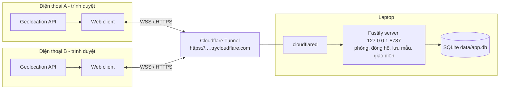
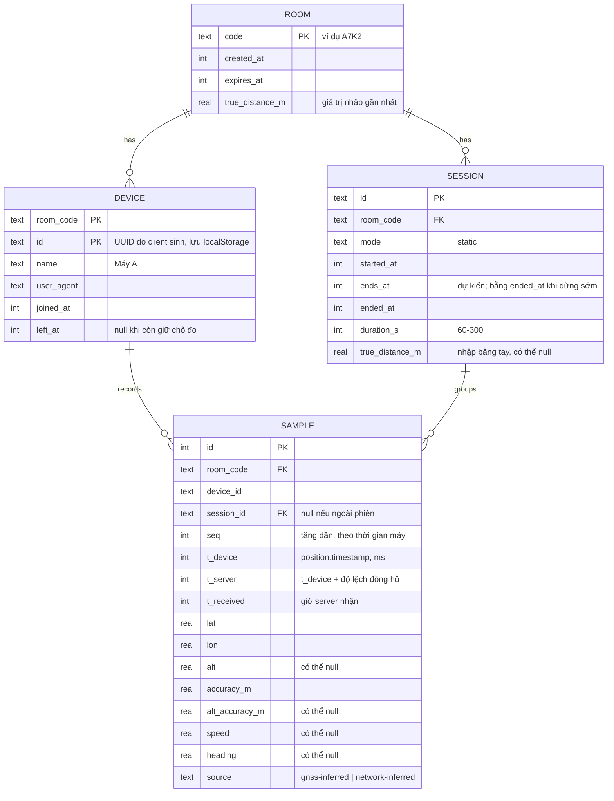

# Kiến trúc hệ thống

Tài liệu mô tả cấu trúc hệ thống, luồng dữ liệu, mô hình dữ liệu và các thuật
toán tính toán. Lý do chọn công nghệ nằm ở [tech-stack.md](./tech-stack.md).

Trạng thái: Giai đoạn 1 **đã cài đặt**; mục "Mở rộng cho các giai đoạn sau" chỉ
là định hướng.

## Mục tiêu

Hai điện thoại vào cùng một phòng. Mỗi máy gửi vị trí khoảng 1 lần/giây. Cả hai
màn hình hiển thị vị trí của hai máy, khoảng cách, độ bất định, và so sánh với
khoảng cách thật do người dùng đo bằng thước.

## Sơ đồ tổng thể (Giai đoạn 1)



`cloudflared` chạy trên laptop và mở kết nối ra ngoài tới Cloudflare, nên không
cần mở cổng router hay có IP công khai.

Server làm ba việc: quản lý phòng, cung cấp đồng hồ chuẩn, lưu và phát lại mẫu
vị trí. Mọi phép tính (khoảng cách, ghép mẫu, thống kê) nằm trong
`packages/shared` và chạy được ở cả client lẫn server, để màn hình và file CSV
luôn ra cùng một kết quả.

## Cấu trúc repo

```text
apps/
  web/            React + Vite client (src/features, src/sync, src/location, e2e/)
  server/         Fastify + WebSocket + SQLite (src/, migrations/, test/)
packages/
  shared/         schema Zod, geo-math, ghép mẫu, thống kê, CSV
docs/
plans/
data/             file SQLite khi chạy (không commit)
```

## Thành phần

### Web client (`apps/web/src`)

| Đường dẫn | Trách nhiệm |
|-----------|-------------|
| `features/home` | Tạo phòng, nhập mã, đặt tên máy; đọc mã từ link `/r/:code` |
| `features/room` | Màn hình phòng: thẻ hai máy, mã + QR, chọn dữ liệu, xóa phòng |
| `features/live` | Khoảng cách và độ bất định từ mẫu mới nhất của hai máy |
| `features/map` | Bản đồ Leaflet và biểu đồ phân tán ENU |
| `features/static-session` | Đo tĩnh: chọn thời lượng, đếm ngược, kết quả trung bình |
| `features/compare` | Nhập khoảng cách thật, thống kê sai số, biểu đồ theo thời gian |
| `features/export` | Link tải CSV |
| `location` | `watchPosition`, suy luận nguồn, Wake Lock, báo trạng thái hiển thị |
| `sync` | WebSocket, kết nối lại, đồng bộ đồng hồ, hàng đợi gửi lại, store Zustand |
| `lib` | Định dạng số kiểu Việt Nam, danh tính thiết bị, chọn tập dữ liệu |

### Server (`apps/server/src`)

| File | Trách nhiệm |
|------|-------------|
| `app.ts` | Dựng Fastify: `/ws`, `/healthz`, CSV, phục vụ giao diện, giới hạn kích thước và tần suất message, dọn dữ liệu mỗi giờ |
| `rooms.ts` | Sinh mã phòng, tối đa 2 máy, trả lời ping đồng hồ, phiên đo tĩnh, phát message, giới hạn thử mã |
| `store.ts` | SQLite: migration, phòng, máy, phiên, mẫu |
| `export.ts` | `GET /api/rooms/:code/export.csv` |
| `config.ts` | Biến môi trường |

### Thư viện dùng chung (`packages/shared/src`)

| Module | Nội dung |
|--------|----------|
| `schema` | Schema Zod cho message WebSocket và mẫu vị trí |
| `geo` | Haversine, ENU cục bộ và ngược lại, suy luận nguồn vị trí |
| `pairing` | Ghép mẫu hai máy theo thời gian |
| `stats` | Thống kê sai số, lọc và lấy trung bình đo tĩnh |
| `csv` | Định dạng CSV mẫu và cặp |

## Mô hình dữ liệu



`(room_code, device_id, seq)` là khóa duy nhất để gửi lại mẫu sau khi mất mạng mà
không bị trùng. `seq` được lấy bằng `max(seq trước + 1, thời gian máy tính bằng ms)`,
nên vẫn tăng và không trùng kể cả khi tải lại trang.

Một mẫu thuộc phiên đo tĩnh nếu `t_server` nằm trong khoảng thời gian của phiên.
Server gán `session_id` theo khoảng thời gian này (không theo lúc nhận), nên mẫu
gửi lại muộn sau khi mất mạng vẫn vào đúng phiên. Phiên đã quá `ends_at` được coi
là kết thúc kể cả khi server khởi động lại.

## Giao thức WebSocket

Tất cả message là JSON có trường `type`, được kiểm tra bằng Zod ở cả hai đầu.

| Chiều | `type` | Nội dung chính |
|-------|--------|----------------|
| C→S | `room.create` | `deviceId`, `name`, `role` (`device` mặc định, hoặc `viewer`) |
| C→S | `room.join` | `code`, `deviceId`, `name`, `role`, `resume` (true khi tự kết nối lại) |
| C→S | `room.leave` | — (máy đo nhường lại chỗ) |
| C→S | `room.delete` | — |
| C→S | `device.kick` | `deviceId` (chỉ máy xem được gửi) |
| S→C | `room.kicked` | — (gửi cho máy bị kick, rồi đóng socket với mã 4001) |
| C→S | `device.status` | `visible` (trang đang hiển thị hay bị ẩn) |
| S→C | `room.state` | mã phòng, khoảng cách thật, máy đo (online, visible), số máy đang xem, danh sách phiên |
| S→C | `room.deleted` | — |
| C→S | `clock.ping` | `t0` (giờ client) |
| S→C | `clock.pong` | `t0`, `ts` (giờ server) |
| C→S | `sample.batch` | 1–600 mẫu (thường 1, nhiều hơn khi gửi lại) |
| S→C | `sample.ack` | `maxSeq` của lô vừa nhận |
| S→C | `sample.history` | mẫu 2 giờ gần nhất và mọi mẫu thuộc phiên, gửi khi vào phòng |
| S→C | `sample.broadcast` | mẫu mới (chưa từng lưu) của máy còn lại |
| C→S | `session.start` | `durationS` (60–300) |
| C→S | `session.stop` | — |
| C→S | `session.truth` | `trueDistanceM` |
| S→C | `error` | `code`, `message` |

**Máy đo và máy xem.** Mỗi phòng có tối đa 2 *máy đo* (`device`): gửi vị trí và
được tính là A/B theo thứ tự vào phòng. *Máy xem* (`viewer`, thường là laptop) chỉ
nhận dữ liệu, có thể tạo phòng, hiện QR, nhập khoảng cách thật và điều khiển phiên
đo, nhưng không chiếm chỗ và bị từ chối nếu gửi vị trí (`viewer-only`). Giao diện
chọn sẵn "Chỉ xem" cho máy không có màn hình cảm ứng. Máy đo bấm "Rời phòng" thì
nhường chỗ (`left_at` được ghi); mẫu đã thu vẫn còn trong CSV. Một trình duyệt từng
là máy đo nếu vào lại bằng chế độ xem cũng nhường chỗ.

**Kick.** Máy xem bấm **Kick** trên thẻ một máy đo: máy đó mất chỗ ngay (không hỏi
lại), nhận `room.kicked` và quay về màn hình đầu; mẫu đã thu vẫn còn trong CSV. Khi
tự kết nối lại, client gửi `resume: true`; server từ chối (`kicked`) nếu máy đó đã
mất chỗ, nên máy bị kick không tự chiếm lại chỗ. Người dùng vẫn có thể bấm **Vào**
bằng tay nếu phòng còn chỗ.

Trạng thái phiên đo đi kèm trong `room.state`. Server phát lại `room.state` khi
có máy vào/ra, đổi trạng thái hiển thị, bắt đầu/dừng/hết giờ phiên, hoặc nhập
khoảng cách thật.

Khi một máy bấm bắt đầu đo tĩnh, server tạo phiên và phát cho cả hai máy, nên hai
máy luôn thu trong cùng một khoảng thời gian.

## Đồng bộ đồng hồ

Đồng hồ hai điện thoại có thể lệch nhau vài trăm mili giây đến vài giây, đủ để
ghép sai mẫu. Client tự ước lượng độ lệch so với server theo cách của NTP:

1. Client gửi `clock.ping` với `t0` (giờ client).
2. Server trả `clock.pong` với `t0` và `ts` (giờ server).
3. Client nhận lúc `t3`. Tính `rtt = t3 - t0` và `offset = ts - (t0 + t3) / 2`.
4. Ping 5 lần khi kết nối, sau đó mỗi 30 giây. Dùng `offset` của lần ping có
   `rtt` nhỏ nhất trong 10 lần gần nhất (ít bị ảnh hưởng bởi trễ mạng nhất).

Mỗi mẫu có `t_server = position.timestamp + offset`. Sai số của cách này khoảng
`rtt / 2`, thường dưới 100 ms trên mạng di động, đủ cho ngưỡng ghép 1 giây.

`t_received` (giờ server nhận mẫu) được lưu thêm để kiểm tra chéo, không dùng để ghép.
Mẫu đến trước khi có lần đo độ lệch đầu tiên được giữ lại và gắn `t_server` ngay khi
có kết quả ping.

## Tập dữ liệu đang xem

Bản đồ, biểu đồ phân tán, so sánh và CSV đều dùng chung một lựa chọn "Dữ liệu":

- **Trực tiếp**: 10 phút gần nhất (CSV khi chọn mục này xuất toàn bộ dữ liệu phòng).
- **Một phiên đo tĩnh**: các mẫu trong khoảng thời gian của phiên đó.

Số khoảng cách lớn trên màn hình luôn lấy từ mẫu mới nhất của hai máy, không phụ
thuộc lựa chọn này.

## Thuật toán

### Khoảng cách Haversine

```text
d = 2R · asin( sqrt( sin²(Δφ/2) + cos φ1 · cos φ2 · sin²(Δλ/2) ) ),  R = 6 371 008.8 m
```

Ở khoảng cách vài chục mét, số thực 64-bit cho sai số làm tròn dưới 1 mm.

### Độ bất định ước tính

```text
σ_d = sqrt(accA² + accB²)
```

Ví dụ: A 4 m, B 3 m thì σ_d = 5 m. Đây là ước tính thô vì `accuracy` là bán kính
ngang (68% trên Android), còn sai số của khoảng cách chỉ phụ thuộc thành phần dọc
theo đường nối hai máy. Con số này nên đọc là "cỡ sai số", và sai số thật được
đo bằng cách so với khoảng cách thước.

### Ghép mẫu theo thời gian

Hai danh sách mẫu đã sắp theo `t_server`. Duyệt bằng hai con trỏ, với mỗi mẫu của
A chọn mẫu B gần nhất về thời gian. Chỉ nhận cặp nếu `|Δt| < 1000 ms` (cấu hình
được). Mỗi mẫu chỉ dùng trong một cặp. Mẫu không ghép được vẫn lưu và vẫn xuất
CSV, nhưng không vào thống kê khoảng cách.

### Tọa độ ENU cục bộ

Lấy mẫu đầu tiên của phiên làm gốc (φ0, λ0). Với khoảng cách dưới 1 km dùng xấp xỉ
phẳng:

```text
east  = R · Δλ · cos φ0
north = R · Δφ
```

ENU dùng cho biểu đồ phân tán theo mét và để lấy trung bình vị trí (không lấy
trung bình trực tiếp trên độ kinh/vĩ).

### Chế độ đo tĩnh

1. Server mở phiên `static` với thời lượng 60–300 giây cho cả hai máy.
2. Mỗi máy thu mẫu như bình thường, gắn `session_id`.
3. Loại mẫu có `accuracy` lớn hơn ngưỡng (mặc định 30 m, cấu hình được) và mẫu
   trong 5 giây đầu (chờ vị trí ổn định).
4. Tính vị trí trung bình mỗi máy trong ENU, đổi lại kinh/vĩ.
5. Khoảng cách tĩnh = Haversine giữa hai vị trí trung bình.
6. Độ phân tán mỗi máy: độ lệch chuẩn theo đông và bắc, và bán kính chứa 50% số
   điểm (CEP50).

Lưu ý: các mẫu GPS liên tiếp tương quan mạnh với nhau. Vì vậy sai số của vị trí
trung bình giảm chậm hơn nhiều so với công thức σ/√N, và app không hiển thị σ/√N
như độ chính xác của kết quả trung bình.

### So sánh với khoảng cách thật

Với mỗi cặp mẫu `i`: `d_i` là khoảng cách Haversine, `e_i = d_i − D_thật`.

| Chỉ số | Công thức | Ý nghĩa |
|--------|-----------|---------|
| Sai số trung bình (bias) | mean(e_i) | Đo dài hay ngắn hơn một cách hệ thống |
| Sai số tuyệt đối trung bình | mean(\|e_i\|) | Độ lệch thường gặp |
| Độ lệch chuẩn | std(e_i) | Mức dao động |
| RMSE | sqrt(mean(e_i²)) | Tổng hợp bias và dao động |
| Sai số lớn nhất | max(\|e_i\|) | Trường hợp xấu nhất |
| Sai số đo tĩnh | d_tĩnh − D_thật | Hiệu quả của việc lấy trung bình |
| Tỉ lệ nằm trong σ_d | tỉ lệ \|e_i\| ≤ σ_d,i | `accuracy` của hệ điều hành có đáng tin không |

Biểu đồ theo thời gian vẽ `d_i`, một đường ngang tại `D_thật`, và dải `±σ_d`.

## Xuất CSV

`GET /api/rooms/:code/export.csv?session=<id>&kind=samples|pairs` trả một trong
hai loại file:

- **samples**: `session_id, device_name, seq, t_device_iso, t_server_iso,
  lat, lon, alt, accuracy_m, alt_accuracy_m, speed, heading, source`
- **pairs**: `t_server_iso, dt_ms, lat_a, lon_a, acc_a, lat_b, lon_b, acc_b,
  distance_m, sigma_m, true_distance_m, error_m`

Dấu phân cách là dấu phẩy, số dùng dấu chấm thập phân, thời gian theo ISO 8601 UTC,
để đọc thẳng bằng pandas. Mở bằng Excel có cài đặt vùng Việt Nam có thể cần chọn
lại dấu phân cách khi import.

## Bảo mật và quyền riêng tư

- Toàn bộ qua HTTPS và WSS (bắt buộc với Geolocation API), do Cloudflare Tunnel cung cấp.
- Server chỉ nghe `127.0.0.1`; chỉ `cloudflared` trên laptop tới được nó.
- Không đăng nhập. Mã phòng 4 ký tự từ bảng 31 ký tự (bỏ `0 O 1 I L`), khoảng
  920 nghìn tổ hợp. Mỗi IP (lấy từ header `cf-connecting-ip`) được nhập sai tối
  đa 20 lần trong 10 phút. Đủ cho công cụ đo; không đủ để bảo vệ dữ liệu nhạy cảm.
- Vị trí là dữ liệu cá nhân: phòng và mẫu bị xóa sau 7 ngày (cấu hình được), có
  nút xóa phòng ngay. Link CSV ai có mã phòng cũng tải được.
- Kiểm tra mọi message bằng Zod; message tối đa 512 KB, tối đa 20 message mỗi giây
  trên một kết nối.

## Xử lý lỗi và trường hợp biên

| Tình huống | Cách xử lý |
|------------|------------|
| Người dùng từ chối quyền vị trí | Màn hình hướng dẫn bật lại theo từng hệ điều hành |
| iPhone tắt màn hình hoặc chuyển app | Wake Lock giữ màn hình; khi trang ẩn, đánh dấu máy "tạm dừng" và báo cho máy kia |
| Mất mạng | Giữ mẫu trong hàng đợi đến khi server xác nhận, gửi lại khi kết nối lại (thử lại sau 1, 2, 4, 5 giây…) |
| Phòng đã đủ 2 máy | Từ chối với thông báo rõ ràng; máy cũ cùng `deviceId` vào lại được |
| Cùng máy mở phòng ở tab thứ hai | Tab mới thay tab cũ; tab cũ quay về màn hình đầu kèm thông báo |
| Không có tín hiệu quá 5 giây | Trạng thái "mất tín hiệu" |
| `accuracy` quá lớn | Vẫn hiển thị nhưng tô cảnh báo, loại khỏi trung bình tĩnh |

## Mở rộng cho các giai đoạn sau

Chưa nằm trong phạm vi hiện tại. Kiến trúc Giai đoạn 1 được giữ nguyên; các giai
đoạn sau thêm thành phần, không thay thế. Giai đoạn 2 cần chạy RTKLIB, nên sẽ cần
cài thêm trên laptop hoặc chuyển sang máy chủ khác.

| Giai đoạn | Thêm vào | Điểm nối |
|-----------|----------|----------|
| 2. GNSS thô | `apps/android`, `workers/rtk` | Android vào phòng bằng cùng giao thức WebSocket; file thô tải qua `POST /api/sessions/:id/raw`; worker ghi kết quả vào bảng `rtk_solution` |
| 3. UWB | `apps/ios`, module UWB trong `apps/android` | Message mới `uwb.token` để trao đổi token qua phòng; mẫu khoảng cách UWB lưu bảng `range_sample` |
| 4. RTK ngoài | Module Bluetooth trong `apps/android` | Mẫu có `source = rtk-fixed / rtk-float`; message `rtcm.relay` nếu dùng base cục bộ |

Trường `source` và bảng thống kê dùng chung cho mọi giai đoạn, nên kết quả GPS
thường, RTK điện thoại, UWB và RTK ngoài so được trên cùng một màn hình và cùng
một file CSV.
