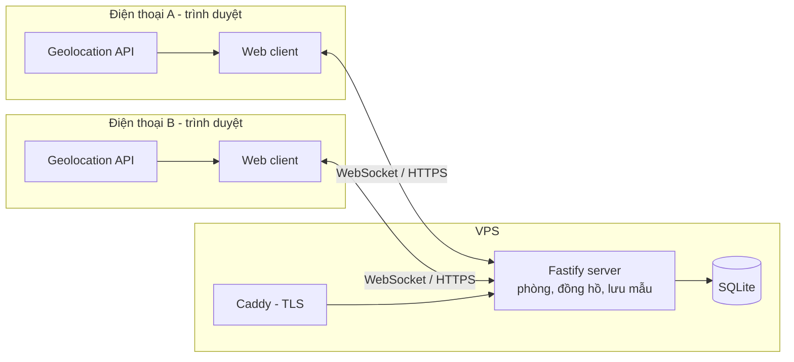
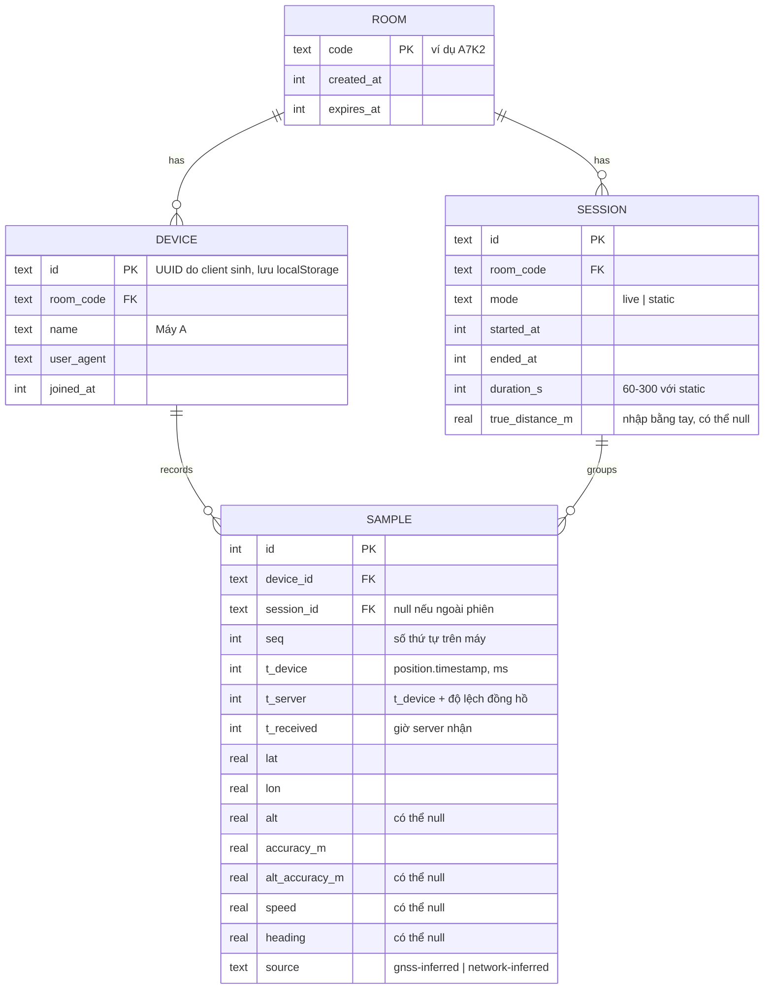

# Kiến trúc hệ thống

Tài liệu mô tả cấu trúc hệ thống, luồng dữ liệu, mô hình dữ liệu và các thuật
toán tính toán. Lý do chọn công nghệ nằm ở [tech-stack.md](./tech-stack.md).

Trạng thái: **đề xuất** (chưa có code).

## Mục tiêu

Hai điện thoại vào cùng một phòng. Mỗi máy gửi vị trí khoảng 1 lần/giây. Cả hai
màn hình hiển thị vị trí của hai máy, khoảng cách, độ bất định, và so sánh với
khoảng cách thật do người dùng đo bằng thước.

## Sơ đồ tổng thể (Giai đoạn 1)



Server làm ba việc: quản lý phòng, cung cấp đồng hồ chuẩn, lưu và phát lại mẫu
vị trí. Mọi phép tính (khoảng cách, ghép mẫu, thống kê) nằm trong
`packages/shared` và chạy được ở cả client lẫn server, để màn hình và file CSV
luôn ra cùng một kết quả.

## Cấu trúc repo

```text
apps/
  web/            React + Vite client
  server/         Fastify + WebSocket + SQLite
  android/        (Giai đoạn 2+) app Kotlin
  ios/            (Giai đoạn 3) app Swift
workers/
  rtk/            (Giai đoạn 2) worker Python chạy RTKLIB
packages/
  shared/         schema Zod, kiểu dữ liệu, geo-math, ghép mẫu, thống kê
docs/
plans/
deploy/           Dockerfile, docker-compose.yml, Caddyfile
```

## Thành phần

### Web client (`apps/web`)

| Module | Trách nhiệm |
|--------|-------------|
| `room` | Tạo/vào phòng, đặt tên máy, hiển thị mã và QR |
| `location` | Gọi `watchPosition`, chuẩn hóa mẫu, suy luận nguồn, giữ màn hình sáng |
| `sync` | Kết nối WebSocket, tự kết nối lại, đo độ lệch đồng hồ, gửi hàng đợi mẫu khi có mạng lại |
| `live` | Màn hình realtime: trạng thái tín hiệu, khoảng cách, độ bất định |
| `static-session` | Chế độ đo tĩnh: đếm ngược, thu, lấy trung bình |
| `compare` | Nhập khoảng cách thật, thống kê sai số, biểu đồ theo thời gian |
| `map` | Bản đồ Leaflet và biểu đồ phân tán ENU |
| `export` | Tải CSV |

### Server (`apps/server`)

| Module | Trách nhiệm |
|--------|-------------|
| `rooms` | Sinh mã phòng, giới hạn 2 máy, hết hạn sau 24 giờ |
| `ws` | Nhận và phát message, kiểm tra bằng schema Zod |
| `clock` | Trả lời ping để client tính độ lệch đồng hồ |
| `store` | Ghi/đọc SQLite |
| `export` | `GET /api/rooms/:code/export.csv` |
| `static` | Phục vụ file build của web client |

### Thư viện dùng chung (`packages/shared`)

| Module | Nội dung |
|--------|----------|
| `schema` | Schema Zod cho message WebSocket và mẫu vị trí |
| `geo` | Haversine, chuyển đổi sang ENU cục bộ và ngược lại |
| `pairing` | Ghép mẫu hai máy theo thời gian |
| `stats` | Trung bình, độ lệch chuẩn, RMSE, sai số lớn nhất |

## Mô hình dữ liệu



`(device_id, seq)` là khóa duy nhất để gửi lại mẫu sau khi mất mạng mà không bị
trùng.

## Giao thức WebSocket

Tất cả message là JSON có trường `type`, được kiểm tra bằng Zod ở cả hai đầu.

| Chiều | `type` | Nội dung chính |
|-------|--------|----------------|
| C→S | `room.create` | `deviceId`, `name` |
| C→S | `room.join` | `code`, `deviceId`, `name` |
| S→C | `room.state` | mã phòng, danh sách máy, trạng thái online, phiên hiện tại |
| C→S | `clock.ping` | `t0` (giờ client) |
| S→C | `clock.pong` | `t0`, `ts` (giờ server) |
| C→S | `sample.batch` | mảng mẫu (thường 1, nhiều hơn khi gửi lại) |
| S→C | `sample.ack` | `seq` cao nhất đã lưu |
| S→C | `sample.broadcast` | mẫu mới của máy còn lại |
| C→S | `session.start` | `mode`, `durationS` |
| C→S | `session.stop` | — |
| C→S | `session.truth` | `trueDistanceM` |
| S→C | `session.state` | trạng thái phiên cho cả hai máy |
| S→C | `error` | `code`, `message` |

Khi một máy bấm bắt đầu đo tĩnh, server tạo phiên và phát cho cả hai máy, nên hai
máy luôn thu trong cùng một khoảng thời gian.

## Đồng bộ đồng hồ

Đồng hồ hai điện thoại có thể lệch nhau vài trăm mili giây đến vài giây, đủ để
ghép sai mẫu. Client tự ước lượng độ lệch so với server theo cách của NTP:

1. Client gửi `clock.ping` với `t0` (giờ client).
2. Server trả `clock.pong` với `t0` và `ts` (giờ server).
3. Client nhận lúc `t3`. Tính `rtt = t3 - t0` và `offset = ts - (t0 + t3) / 2`.
4. Ping 5 lần khi kết nối, sau đó mỗi 30 giây. Dùng `offset` của lần ping có
   `rtt` nhỏ nhất trong 10 lần gần nhất (ít bị ảnh hưởng bởi trễ mạng nhất).

Mỗi mẫu có `t_server = position.timestamp + offset`. Sai số của cách này khoảng
`rtt / 2`, thường dưới 100 ms trên mạng di động, đủ cho ngưỡng ghép 1 giây.

`t_received` (giờ server nhận mẫu) được lưu thêm để kiểm tra chéo, không dùng để ghép.

## Thuật toán

### Khoảng cách Haversine

```text
d = 2R · asin( sqrt( sin²(Δφ/2) + cos φ1 · cos φ2 · sin²(Δλ/2) ) ),  R = 6 371 008.8 m
```

Ở khoảng cách vài chục mét, số thực 64-bit cho sai số làm tròn dưới 1 mm.

### Độ bất định ước tính

```text
σ_d = sqrt(accA² + accB²)
```

Ví dụ: A 4 m, B 3 m thì σ_d = 5 m. Đây là ước tính thô vì `accuracy` là bán kính
ngang (68% trên Android), còn sai số của khoảng cách chỉ phụ thuộc thành phần dọc
theo đường nối hai máy. Con số này nên đọc là "cỡ sai số", và sai số thật được
đo bằng cách so với khoảng cách thước.

### Ghép mẫu theo thời gian

Hai danh sách mẫu đã sắp theo `t_server`. Duyệt bằng hai con trỏ, với mỗi mẫu của
A chọn mẫu B gần nhất về thời gian. Chỉ nhận cặp nếu `|Δt| < 1000 ms` (cấu hình
được). Mỗi mẫu chỉ dùng trong một cặp. Mẫu không ghép được vẫn lưu và vẫn xuất
CSV, nhưng không vào thống kê khoảng cách.

### Tọa độ ENU cục bộ

Lấy mẫu đầu tiên của phiên làm gốc (φ0, λ0). Với khoảng cách dưới 1 km dùng xấp xỉ
phẳng:

```text
east  = R · Δλ · cos φ0
north = R · Δφ
```

ENU dùng cho biểu đồ phân tán theo mét và để lấy trung bình vị trí (không lấy
trung bình trực tiếp trên độ kinh/vĩ).

### Chế độ đo tĩnh

1. Server mở phiên `static` với thời lượng 60–300 giây cho cả hai máy.
2. Mỗi máy thu mẫu như bình thường, gắn `session_id`.
3. Loại mẫu có `accuracy` lớn hơn ngưỡng (mặc định 30 m, cấu hình được) và mẫu
   trong 5 giây đầu (chờ vị trí ổn định).
4. Tính vị trí trung bình mỗi máy trong ENU, đổi lại kinh/vĩ.
5. Khoảng cách tĩnh = Haversine giữa hai vị trí trung bình.
6. Độ phân tán mỗi máy: độ lệch chuẩn theo đông và bắc, và bán kính chứa 50% số
   điểm (CEP50).

Lưu ý: các mẫu GPS liên tiếp tương quan mạnh với nhau. Vì vậy sai số của vị trí
trung bình giảm chậm hơn nhiều so với công thức σ/√N, và app không hiển thị σ/√N
như độ chính xác của kết quả trung bình.

### So sánh với khoảng cách thật

Với mỗi cặp mẫu `i`: `d_i` là khoảng cách Haversine, `e_i = d_i − D_thật`.

| Chỉ số | Công thức | Ý nghĩa |
|--------|-----------|---------|
| Sai số trung bình (bias) | mean(e_i) | Đo dài hay ngắn hơn một cách hệ thống |
| Sai số tuyệt đối trung bình | mean(\|e_i\|) | Độ lệch thường gặp |
| Độ lệch chuẩn | std(e_i) | Mức dao động |
| RMSE | sqrt(mean(e_i²)) | Tổng hợp bias và dao động |
| Sai số lớn nhất | max(\|e_i\|) | Trường hợp xấu nhất |
| Sai số đo tĩnh | d_tĩnh − D_thật | Hiệu quả của việc lấy trung bình |
| Tỉ lệ nằm trong σ_d | tỉ lệ \|e_i\| ≤ σ_d,i | `accuracy` của hệ điều hành có đáng tin không |

Biểu đồ theo thời gian vẽ `d_i`, một đường ngang tại `D_thật`, và dải `±σ_d`.

## Xuất CSV

`GET /api/rooms/:code/export.csv?session=<id>&kind=samples|pairs` trả một trong
hai loại file:

- **samples**: `session_id, device_name, seq, t_device_iso, t_server_iso,
  lat, lon, alt, accuracy_m, alt_accuracy_m, speed, heading, source`
- **pairs**: `t_server_iso, dt_ms, lat_a, lon_a, acc_a, lat_b, lon_b, acc_b,
  distance_m, sigma_m, true_distance_m, error_m`

Dấu phân cách là dấu phẩy, số dùng dấu chấm thập phân, thời gian theo ISO 8601 UTC,
để đọc thẳng bằng pandas. Mở bằng Excel có cài đặt vùng Việt Nam có thể cần chọn
lại dấu phân cách khi import.

## Bảo mật và quyền riêng tư

- Toàn bộ qua HTTPS và WSS (bắt buộc với Geolocation API).
- Không đăng nhập. Mã phòng 4 ký tự từ bảng 31 ký tự (bỏ `0 O 1 I L`), khoảng
  920 nghìn tổ hợp, kèm giới hạn tốc độ thử mã theo IP. Đủ cho công cụ đo; không
  đủ để bảo vệ dữ liệu nhạy cảm.
- Vị trí là dữ liệu cá nhân: phòng và mẫu bị xóa sau 7 ngày (cấu hình được), có
  nút xóa phòng ngay.
- Kiểm tra mọi message bằng Zod; giới hạn kích thước message và số mẫu mỗi giây.

## Xử lý lỗi và trường hợp biên

| Tình huống | Cách xử lý |
|------------|------------|
| Người dùng từ chối quyền vị trí | Màn hình hướng dẫn bật lại theo từng hệ điều hành |
| iPhone tắt màn hình hoặc chuyển app | Wake Lock giữ màn hình; khi trang ẩn, đánh dấu máy "tạm dừng" và báo cho máy kia |
| Mất mạng | Giữ mẫu trong hàng đợi, gửi lại theo `seq` khi kết nối lại |
| Phòng đã đủ 2 máy | Từ chối với thông báo rõ ràng; máy cũ cùng `deviceId` vào lại được |
| Không có tín hiệu quá 5 giây | Trạng thái "mất tín hiệu" |
| `accuracy` quá lớn | Vẫn hiển thị nhưng tô cảnh báo, loại khỏi trung bình tĩnh |

## Mở rộng cho các giai đoạn sau

Kiến trúc Giai đoạn 1 được giữ nguyên; các giai đoạn sau thêm thành phần, không
thay thế.

| Giai đoạn | Thêm vào | Điểm nối |
|-----------|----------|----------|
| 2. GNSS thô | `apps/android`, `workers/rtk` | Android vào phòng bằng cùng giao thức WebSocket; file thô tải qua `POST /api/sessions/:id/raw`; worker ghi kết quả vào bảng `rtk_solution` |
| 3. UWB | `apps/ios`, module UWB trong `apps/android` | Message mới `uwb.token` để trao đổi token qua phòng; mẫu khoảng cách UWB lưu bảng `range_sample` |
| 4. RTK ngoài | Module Bluetooth trong `apps/android` | Mẫu có `source = rtk-fixed / rtk-float`; message `rtcm.relay` nếu dùng base cục bộ |

Trường `source` và bảng thống kê dùng chung cho mọi giai đoạn, nên kết quả GPS
thường, RTK điện thoại, UWB và RTK ngoài so được trên cùng một màn hình và cùng
một file CSV.
